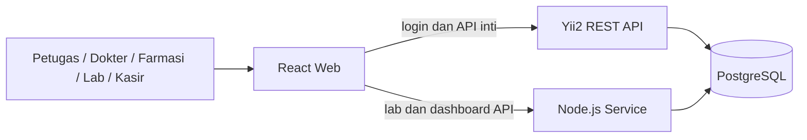

# Arsitektur Aplikasi

Aplikasi dibagi menjadi tiga bagian utama. Tujuannya supaya business logic tetap terpusat di Yii, sementara Node dipakai untuk service pendukung.

## Komponen

| Komponen | Peran |
|----------|-------|
| React + Tailwind CSS | Frontend untuk petugas, dokter, farmasi, lab, kasir, dan admin. |
| Yii2 REST API | Pemilik business logic utama, autentikasi, role, dan transaksi data inti. |
| Node.js service | API laboratorium dan dashboard aggregate. |
| PostgreSQL | Database utama untuk semua layanan. |

## Diagram arsitektur

## Alur komunikasi

### Login dan akses fitur

1. User login lewat Yii.
2. Yii memeriksa username/password lalu menerbitkan JWT.
3. React menyimpan token dan mengirimnya pada setiap request.
4. Yii memeriksa role user sebelum menjalankan endpoint inti.
5. Node memverifikasi JWT yang sama untuk endpoint lab dan dashboard.

### Alur rawat jalan

1. Petugas mencari pasien dan membuat kunjungan lewat Yii.
2. Yii membuat nomor antrean dalam transaction.
3. Dokter membuka antrean dan mengisi pemeriksaan lewat Yii.
4. Tindakan yang dipilih disimpan sebagai item tagihan dengan snapshot tarif.
5. Resep dibuat lewat Yii. Saat obat diserahkan, Yii mengurangi stok dalam transaction.
6. Permintaan lab dibuat lewat Yii sekaligus dengan item tagihan `LAB`.
7. Node membaca order lab yang sama, lalu petugas lab memproses status dan menginput hasil lewat Node.
8. Dokter membaca status/hasil lab dari endpoint Node pada detail kunjungan.
9. Yii menggabungkan biaya pendaftaran, tindakan, lab, dan obat ke invoice.
10. Kasir mencatat pembayaran lewat Yii dengan idempotency key.

## Batas tanggung jawab

- Yii adalah sumber kebenaran untuk kunjungan, stok, billing, pembayaran, dan riwayat pasien.
- Node hanya mengelola data lab serta menyediakan aggregate dashboard.
- Node tidak menghitung total tagihan dan tidak mengubah stok/payment.
- Perubahan data inti selalu dilakukan lewat endpoint Yii.
