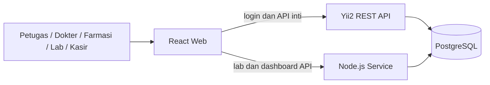

# Arsitektur Aplikasi

Aplikasi dibagi menjadi tiga bagian utama. Tujuannya supaya business logic tetap terpusat di Yii, sementara Node dipakai untuk service pendukung.

## Komponen

| Komponen | Peran |
|----------|-------|
| React + Tailwind CSS | Frontend untuk petugas, dokter, farmasi, lab, kasir, dan admin. |
| Yii2 REST API | Pemilik business logic utama, autentikasi, role, dan transaksi data inti. |
| Node.js service | API laboratorium dan dashboard aggregate. |
| PostgreSQL | Database utama untuk semua layanan. |

## Diagram arsitektur

## Alur komunikasi

### Login dan akses fitur

1. User login lewat Yii.
2. Yii memeriksa username/password lalu membuat JWT.
3. React menyimpan token dan mengirimnya pada setiap request.
4. Yii memeriksa role user (RBAC) sebelum menjalankan endpoint inti.
5. Node memverifikasi JWT yang sama untuk endpoint lab dan dashboard.

### Alur rawat jalan
1. Petugas pendaftaran mencari pasien yang sudah terdaftar, lalu mendaftarkannya ke antrean lewat Yii.
2. Yii membuat nomor antrean di dalam transaction.
3. Dokter membuka list antrean dan mengisi hasil pemeriksaan lewat Yii.
4. Tindakan yang diberikan dokter dicatat sebagai item tagihan, lengkap dengan tarif saat itu tidak   bergantung dengan perubahan master data.
5. Dokter membuat resep lewat Yii. Saat farmasi menyerahkan obat, Yii mengurangi stok di dalam transaction.
6. Kalau perlu lab, dokter membuat permintaan lab lewat Yii, dan biaya lab langsung masuk sebagai item tagihan `LAB`.
7. Petugas lab melihat order itu lewat Node, lalu mengubah statusnya dan mengisi hasil lewat Node juga.
8. Dokter melihat status dan hasil lab dari Node di halaman detail / list antrian pasien.
9. Biaya pendaftaran, tindakan, lab, dan obat terkumpul di satu invoice.
10. Kasir mencatat pembayaran lewat Yii dengan idempotency key.

## Batas tanggung jawab

- Data kunjungan, stok, billing, pembayaran, dan riwayat pasien dikelola dan diubah hanya lewat Yii.
- Node hanya mengelola data lab serta menyediakan aggregate dashboard.
- Node tidak menghitung total tagihan dan tidak mengubah stok/payment.
- Perubahan data inti selalu dilakukan lewat endpoint Yii.
