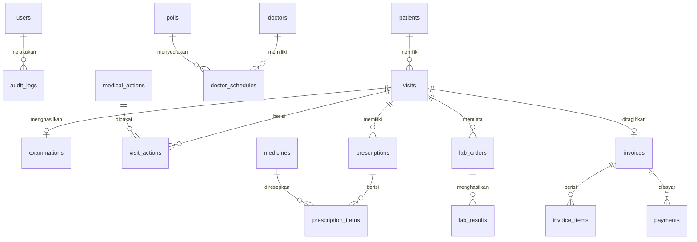

# Skema Database

Skema ini dirancang untuk mendukung alur rawat jalan dengan tetap sederhana.

## Tabel utama

| Tabel | Fungsi |
|-------|--------|
| `users` | Akun dan role pengguna. |
| `patients` | Data pasien dan nomor rekam medis. |
| `doctors` | Data dokter. |
| `polis` | Unit pelayanan. |
| `doctor_schedules` | Jadwal praktik dokter per poli. |
| `medical_actions` | Master tindakan dan tarif. |
| `medicines` | Master obat, stok, dan harga. |
| `visits` | Kunjungan rawat jalan dan status antrean. |
| `examinations` | Rekam medis per kunjungan. |
| `visit_actions` | Tindakan yang dilakukan pada kunjungan. |
| `prescriptions` | Resep dokter. |
| `prescription_items` | Detail obat pada resep. |
| `lab_orders` | Permintaan pemeriksaan lab. |
| `lab_results` | Hasil pemeriksaan lab. |
| `invoices` | Tagihan per kunjungan. |
| `invoice_items` | Rincian biaya dengan snapshot harga. |
| `payments` | Pembayaran bertahap dan idempotency key. |
| `audit_logs` | Riwayat perubahan data penting. |

## Relasi utama

## Aturan konsistensi

- `patients.medical_record_no` harus unik.
- `visits` mencegah kunjungan aktif ganda untuk pasien yang sama.
- `invoice_items` menyimpan nama layanan dan harga sebagai snapshot.
- `payments.idempotency_key` harus unik untuk mencegah pembayaran ganda.
- `medicines.stock` memakai `CHECK (stock >= 0)`.
- Index dibuat pada kolom yang sering dipakai filter: tanggal, status, `patient_id`, `visit_id`.
